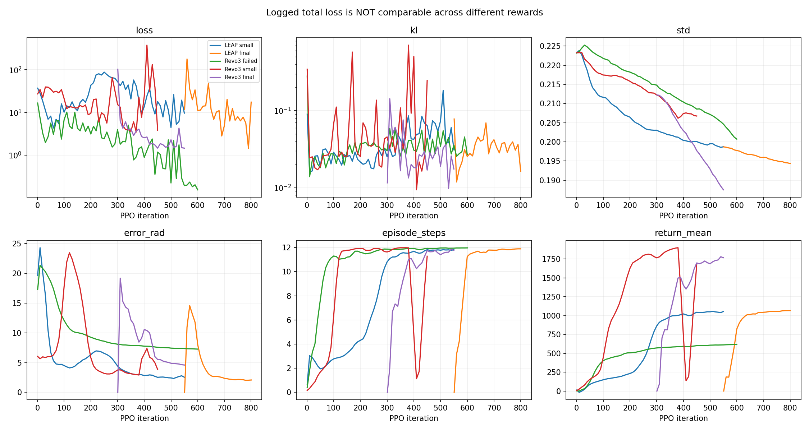
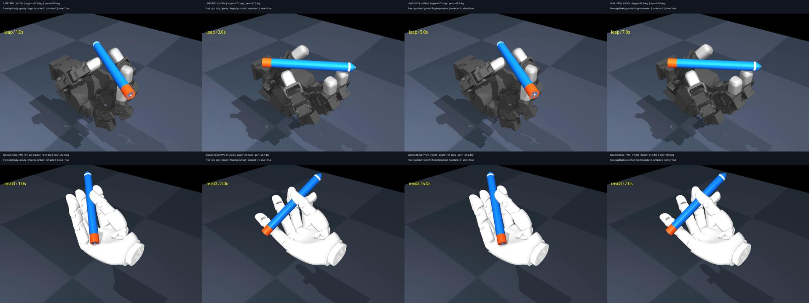
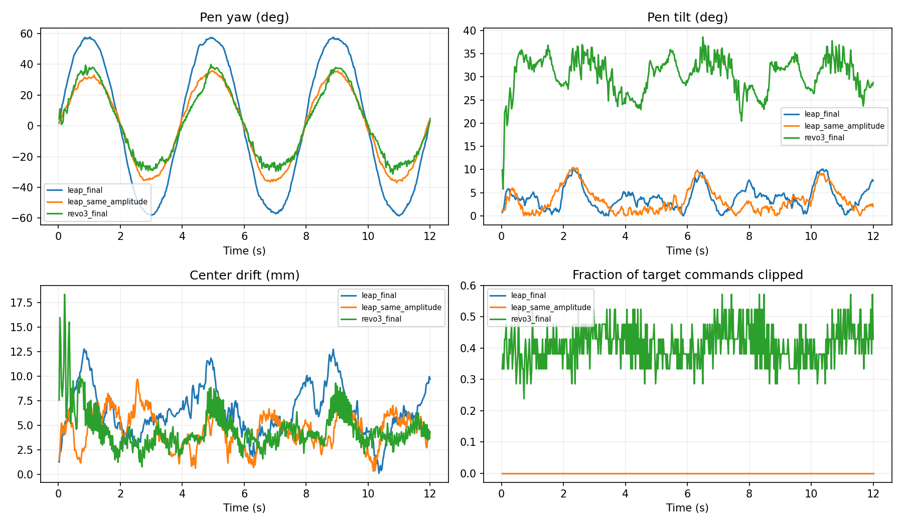

# LEAP 与 Revo3 转笔：数据对比、问题诊断与下一步训练计划

日期：2026-09-22。范围：当前项目中已经训练的仿真策略，不评价两款实物手的绝对能力。

## 1. 结论

**当前 Revo3 的问题不是简单的 loss 偏高，也不能据此判定 Revo3 硬件不适合转笔。当前策略更接近“倾斜、较紧的多指夹持下摆动”，而 LEAP 的笔更水平、正反转幅度更对称。**

之前的“100% 成功”仅表示通过旧判据：不掉落、跨过目标幅度的 60%、平均误差小于 0.25 rad，以及多指接近/接触。它没有限制笔的倾斜，也没有禁止非指尖接触，更没有检查动作裁剪、抓握力或换指质量。将此直接当作高质量转笔成功，评价偏乐观。

本次得到的主要证据：

1. **初始抓姿和动作尺度存在明确问题。** Revo3 有 11/21 个 `home` 控制目标距限位不足 2°，其中多数几乎贴住限位；运行时 41.02% 的“关节×控制时刻”目标被限位裁剪。LEAP 为 0%。
2. **倾斜是肉眼效果差的重要来源。** 同幅度测试中 Revo3 平均倾斜 30.49°，LEAP 3.65°；当前奖励和验收没有充分约束这一点。
3. **更多接触不等于更灵巧。** Revo3 平均 2.89 根远端指节接触笔，但法向接触力标量和约 9.79 N，LEAP 同幅度约 1.15 N。持续多点强夹持可能抑制滚动和接触转换，这是有数据支持、仍需消融验证的机制推断。
4. **软层和执行器未做实物辨识。** 刚体网格、统一摩擦和理想位置执行器不能等同于真实硅胶指腹与电机系统；但没有证据把当前仿真效果差直接归因于“硅胶不好”。
5. **单纯提高求解精度没有解决主要现象。** 本次步长/求解迭代敏感性实验中，倾斜与裁剪率基本不变。

本轮只新增诊断脚本、数据和报告；未修改现有训练环境、资产、权重或启动新训练。

## 2. 数据来源与可复现性

- 正式交付：`artifacts/leap/policy.pt`、`artifacts/revo3/v1.0/policy.pt`。
- 同幅度对照：`runs/ppo_direct/checkpoint_000550.pt`，LEAP ±0.6 rad。
- 小幅参考：`artifacts/revo3/v1.0/small/policy.pt`，Revo3 ±0.35 rad。
- 读取 `runs/*/config.json`、`metrics.jsonl`、checkpoint 和现有评估报告；没有从截图估算 loss。
- 完整解码两份 12 秒、40 FPS 的最终 MP4，抽取关键时刻对比；倾斜、力和裁剪数据来自重新执行策略的 CPU 闭环仿真，不是从画面猜测。
- 新增诊断每个策略 **4 次 × 12 秒，种子 20260923**，相同初始化噪声分布和控制频率。不同手的几何与抓姿不同，不宣称初态完全相同。这是小样本机制诊断，不代替正式大样本可靠性测试。
- 力数据是当前 MuJoCo 模型的求解结果，不是实物力传感器读数。法向力标量和包含不同方向接触，不能当作对笔的合力、托举力或单个指尖的捏力。

文件入口：

- [训练阶段汇总 CSV](training_summary.csv) / [JSON](training_summary.json)
- [新诊断数据 CSV](diagnostics.csv) / [含逐关节结果的 JSON](diagnostics.json)
- [Revo3 逐关节裁剪与力矩数据](revo3_final_joints.csv)
- [数值敏感性实验](solver_sensitivity.json)
- [可复现分析脚本](analyze.py)

运行基础对比：

```bash
.venv-warp/bin/python reports/hand_comparison/analyze.py
```

求解敏感性实验使用同一脚本中的 `rollout`，分别设置 `physics_dt=.0025` 或 `solver_iterations=32`；均为 4 次 × 12 秒，其他参数保持默认。只在内存中修改模型。

## 3. 训练参数对比

### 3.1 共同的 PPO 设置

| 参数 | 两款手当前实现 |
|---|---|
| 算法 | PPO + GAE，直接策略，无示范/参考轨迹残差 |
| Actor / Critic | 分开的 MLP，各为 256 → 256 → 128，ELU |
| 并行环境 | 1,024 |
| rollout horizon | 32 个控制步，即 0.8 秒 |
| 每轮采样 | 32,768 个环境步 |
| 每轮优化 | 最多 4 epochs，每 epoch 8 minibatches，每批 4,096 样本 |
| PPO clip / γ / λ | 0.2 / 0.99 / 0.95 |
| value loss 系数 / entropy 系数 | 0.5 / 0.002 |
| 梯度范数上限 | 1.0 |
| 优化器 | Adam；没有显式学习率调度 |
| KL 早停阈值 | 0.025；当前仅在 epoch 末检查最后一个 minibatch 的估计 |
| 初始动作标准差 | exp(-1.5) ≈ 0.2231；可学习，范围约 0.0498–1.0 |
| 观测 | 仿真特权状态，运行均值/方差归一化；无触觉力输入 |
| 控制频率 / 物理步长 | 40 Hz / 5 ms，每个动作 5 个子步 |
| 回合长度 | 12 秒，即 480 个控制步 |
| 动作语义 | `clip(home + 0.65 * clip(action, -1, 1), joint_limits)` |
| 初始化噪声 | 关节 0.005 rad；笔中心位置 0.4 mm |
| 训练种子 | 仅种子 1；没有多训练种子稳定性统计 |
| 动力学随机化 | 未加入质量、摩擦、增益、时延、软层等随机化 |

### 3.2 两个最终策略的训练谱系

| 参数 | LEAP 最终策略 | Revo3 最终策略 |
|---|---:|---:|
| 手指数 / 动作维度 | 4 / 16 | 5 / 21 |
| 观测维度 | 66 | 81 |
| 第一阶段幅度 | ±0.6 rad / ±34.4° | ±0.35 rad / ±20.1° |
| 第一阶段有效轮数 | 550 | 300 |
| 第二阶段幅度 | ±1.0 rad / ±57.3° | ±0.6 rad / ±34.4° |
| 第二阶段有效轮数 | 250 | 250 |
| 目标周期 | 4 秒 | 4 秒 |
| 学习率 | 3e-4 → 1.5e-4 | 3e-4 → 1e-4 |
| 有效训练环境步 | 26,214,400 | 18,022,400 |
| 所选谱系日志累计训练时间 | 347.9 秒，约 5.8 分钟 | 876.4 秒，约 14.6 分钟 |
| 第二阶段吞吐 | 73,010 环境步/秒 | 20,250 环境步/秒 |
| 最终 checkpoint 轮次 | 800 | 550 |
| 最终训练动作标准差 | 0.1944 | 0.1875 |

“有效训练”只统计通往所选权重的谱系，不含失败实验、未选用的继续训练、编译、评估和抓姿搜索。`config.json` 的 `iterations` 是启动时计划追加的轮数，不能当成该策略实际训练总轮数。Revo3 另有 600 轮旧奖励失败实验，小幅分支也继续训练到约第 450 轮后被停止。

### 3.3 物理参数与表示

| 参数 | LEAP 当前仿真 | Revo3 当前仿真 |
|---|---:|---:|
| 每关节位置增益 kp | 3.0 | 3.0 |
| 关节阻尼 | 0.2 | 0.08 |
| armature | 0.00149376 | 0.0002 |
| 关节摩擦损失 | 0.02 | 0.01 |
| 关节执行器力矩限幅 | ±0.2196 N·m | ±0.35 N·m |
| 非拇指侧摆关节范围 | 约 ±60° | 当前资产为 ±15° |
| 指尖碰撞几何 | 简化 box | 官方凸碰撞 mesh |
| 指尖滑动摩擦系数 | 1.2 | 1.2 |
| 指尖 geom solref | 0.02, 1.5 | 0.01, 1.0 |
| 笔 geom solref | 0.01, 1.0 | 0.01, 1.0 |
| 接触维度 condim | 3 | 3 |
| 显式柔性体 / skin 数量 | 0 / 0 | 0 / 0 |
| 总几何体数量 / mesh 数量 | 61 / 12 | 76 / 72 |
| 初始笔倾斜角 | 1.87° | 15.51° |
| 距限位不足 2° 的 home 目标 | 0 / 16 | 11 / 21 |

两者均为手掌固定、重力 -9.81 m/s²、自由刚体笔、无笔驱动/绑定。笔均为 180 mm × 18 mm、25 g。上表是**模型值而非硬件实测值**；相同 kp 不代表相同动态响应，模型复杂度与吞吐也不能只按动作维度解释。

## 4. Loss 与奖励：必须分开解读

代码记录的 `loss` 是本轮执行过的 minibatch 的复合目标均值：

`L_total = L_PPO_clip + 0.5 * mean((V - return)^2) - 0.002 * entropy`

不是“转笔角度损失”。`error_rad` 才是另行统计的训练回合平均角度误差；训练回报、回合长度和角度误差还是最近约 30 个有完成回合的训练轮次的平滑统计，与当前单个确定性策略的评估口径不同。

| 分支 / 所选轮次 | 日志总 loss | 最近 100 轮已记录 loss 的中位数 | 该日志点 KL | 训练平均角度误差 | 训练平均回合时长 |
|---|---:|---:|---:|---:|---:|
| LEAP 小幅 / 550 | 9.6392 | 10.5284 | 0.03104 | 2.54° | 11.83 s |
| LEAP 最终 / 800 | 17.5286 | 7.1711 | 0.01632 | 2.08° | 11.90 s |
| Revo3 旧奖励失败 / 600 | 0.2705 | 0.4046 | 0.02701 | 7.27° | 11.97 s |
| Revo3 小幅 / 300 | 15.4603 | 16.9087 | 0.04562 | 3.75° | 11.64 s |
| Revo3 最终 / 550 | 1.4641 | 1.6140 | 0.01749 | 4.60° | 11.77 s |

**Revo3 失败分支的 loss 最低，却在正式任务测试中成功率为 0%。** 因此不能由 `1.46 < 17.53` 推出 Revo3 比 LEAP 学得更好。

日志没有分别保存 actor loss、critic loss、entropy、explained variance、clip fraction 或完整批次 KL；无法从现有 checkpoint 准确补算当时这些值。下一轮必须补齐。图中 KL 也只是已记录点的最后 minibatch 估计，不是全训练的真实最大 KL。

奖励差异如下：

| 项 | LEAP legacy | Revo3 fingertip |
|---|---|---|
| yaw 角度跟踪 | `2 exp(-e²/0.09)` | 相同 |
| yaw 速度跟踪 | 权重 0.5 | 权重 0.4 |
| 指尖接近 | 很弱的平均距离惩罚 | 最近两个指尖的接近奖励，最高 1.5 |
| 真实接触数 | 无直接奖励 | 每个远端指节 +0.5，最多 +1.5 |
| 非指尖接触 | 无直接惩罚 | 每个接触点 -0.8，最多 -2.4 |
| 中心漂移惩罚 | `-12 × drift` | `-25 × drift` |
| 倾斜惩罚 | `-1.5 × axis_z²` | `-2 × axis_z²` |
| 动作变化 / 动作大小惩罚 | 0.008 / 0.003 | 0.01 / 0.004 |
| 失败惩罚 | -5 | -8 |
| 工作空间 | 漂移 75 mm；中心高度 15 mm | 另加漂移 45 mm、中心下降 18 mm 限制 |

Revo3 的接近与接触正奖励最高合计 3.0，超过角度跟踪单项的 2.0；但倾斜 30° 只扣约 0.5。它可能选择维持三个接触、允许笔倾斜来换取更高累计奖励。惩罚只看中心高度也有漏洞：180 mm 长的笔倾斜 30° 时，两端高度差约 90 mm，中心位置仍能基本不变。



## 5. 动作数据：正式成绩与同条件诊断

### 5.1 原有正式评估

| 项 | LEAP 最终 | Revo3 最终 |
|---|---:|---:|
| 目标幅度 | ±57.3° | ±34.4° |
| GPU 128 × 12 s 旧判据成功率 | 100% | 100% |
| GPU 平均角度误差 | 2.58° | 3.31° |
| CPU 32 × 60 s 旧判据成功率 | 100% | 100% |
| CPU 平均角度误差 | 2.80° | 3.37° |
| CPU 测试种子 | 901 | 20260922 |

这张表并不是完全同条件排名：目标幅度、测试种子和接触成功条件均有差异。Revo3 额外要求超过 80% 时刻有至少两个远端指节接触；两者都未把倾斜和非指尖接触纳入成功判定。

### 5.2 新增同条件 CPU 诊断

均为 4 × 12 s、种子 20260923、同一控制周期和噪声分布。百分比“裁剪率/力矩饱和率”的分母是所有关节×所有控制时刻。

| 指标 | LEAP 最终 ±57.3° | LEAP 同幅度 ±34.4° | Revo3 ±34.4° |
|---|---:|---:|---:|
| 平均角度误差 | 2.70° | 1.54° | 3.51° |
| 95% 分位角度误差 | 8.06° | 4.37° | 8.71° |
| 误差 / 目标幅度 | 4.72% | 4.48% | 10.20% |
| 周期正向峰值均值 | +57.34° | +35.13° | +39.00° |
| 周期反向峰值均值 | -57.82° | -36.09° | -29.75° |
| 平均倾斜 / 95% 分位 | 3.69° / 8.35° | 3.65° / 9.20° | 30.49° / 36.38° |
| 平均中心漂移 | 6.42 mm | 4.89 mm | 4.64 mm |
| 至少两根远端指节接触 | 90.42% | 83.13% | 99.84% |
| 非指尖接触帧占比 | 0% | 0% | 38.13% |
| 掌心接触帧占比 | 0% | 0% | 9.22% |
| 目标被关节限位裁剪 | 0% | 0% | 41.02% |
| 网络动作被 [-1,1] 裁剪 | 2.29% | 0.17% | 3.19% |
| 力矩达到限幅 99% 的比例 | 50.95% | 53.04% | 28.57% |
| 关节速度 RMS | 0.688 rad/s | 0.684 rad/s | 1.830 rad/s |
| 各接触法向力标量和均值 | 1.37 N | 1.15 N | 9.79 N |
| 非指尖法向力标量和占比 | 0% | 0% | 3.20% |
| 掌心法向力标量和占比 | 0% | 0% | 0.72% |

重要辨析：

- Revo3 的平移漂移并不更差，问题主要不是“夹不住”，而是姿态、接触方式、控制余量与动作质量。
- 掌心虽然偶有接触，但法向力占比很小；**不能把这组数据解读成笔主要靠掌心托住**。更显著的是多指夹持较紧以及笔倾斜。
- LEAP 的力矩饱和率反而更高。因此没有证据将 Revo3 较差简单归因于电机力矩不够；也不应因为 LEAP 动画好看就认为其执行器模型已具备真机可信度。
- 接触统计按整个远端刚体归类，不保证接触发生在真实硅胶指腹的有效区域；这也是当前指标的局限。





### 5.3 求解精度敏感性

不训练，仅在内存中改变数值设置，以相同种子执行原 Revo3 策略 4 × 12 s。

| 设置 | MAE | 平均倾斜 | 目标裁剪率 | 存活率 |
|---|---:|---:|---:|---:|
| 原设置：5 ms、8 迭代 | 3.51° | 30.49° | 41.02% | 100% |
| 2.5 ms、8 迭代，仍 40 Hz 控制 | 3.65° | 30.73° | 40.90% | 100% |
| 5 ms、32 迭代 | 3.29° | 30.56° | 40.87% | 100% |

这些结果不支持“主要是步长太大/求解迭代太少”的解释，但不能证明碰撞材料、摩擦或实物参数已经正确。

## 6. 多方面原因分析

### A. 机构、自由度与可操作空间——高优先级

已确认：当前模型为 LEAP 4×4=16 关节，Revo3 拇指 5 关节、其他四指各 4 关节。多出的关节不自动转化为转笔所需方向上的可操作空间。LEAP 的原始设计特别强调屈曲姿态下的侧摆能力，不能按手指数或总自由度简单比较。[LEAP 官方项目](https://v1.leaphand.com/)

当前 Revo3 资产把四指侧摆限制为 ±15°，而 LEAP 相应关节约 ±60°；Revo3 的长串联手指、拇指对掌姿态、指间距和笔相对掌心的位置，也会改变可施加力矩的方向与接触转换空间。后半句属于机制推断，应该用带关节限位、碰撞约束的抓姿/雅可比分析验证，不是对实物能力的定论。

另有版本风险：固定 commit 的 Revo3 MJCF 与现行官方手册存在限位差异，例如模型拇指 MCP 为 0–50°，手册为 0–75°，模型四指侧摆统一 ±15°而手册按手指区分。应核对具体硬件、零位和关节映射，**不能直接把手册数字写入资产来提高仿真成绩**。[Revo3 官方手册](https://www.brainco-hz.com/docs/revolimb-hand/revo3/parameters.html)

### B. 初始抓姿与统一动作尺度——证据最直接

`calibrate_revo3.py` 只搜索 27 组中心位置/高度/指尖偏移，依靠指尖位置 IK 和 2 秒重力稳定性筛选。没有把关节限位余量、接触法向、正反方向旋转可行性或接触转换能力纳入明确目标。它找到了“能夹住”的姿态，不等于“适合转”的姿态。

Revo3 有 11 个 home 目标几乎落在关节边界；初始笔也已倾斜 15.51°。最终策略中：

- 拇指 MCP 目标被裁剪 100% 的控制时刻。
- 小指 PIP 约 96.35%，拇指 DIP 约 95.83%。
- 中指侧摆约 77.60%。

这不是说相应实际关节完全不动；而是策略继续输出限位外的目标时，最终命令不再改变，很多不同动作变成相同执行结果。统一 ±37.2° 的 home 残差对不同关节的量程和余量明显不合适。

### C. 软硅胶层、表面材料与接触几何——重要但尚未实测

两款手当前均没有显式可变形软层。`solref/solimp` 是接触约束近似，不能当作硅胶厚度、硬度、弹性模量或粘弹性的标定结果。真实软指腹可能改变接触面积、压力分布、滚动、扭转阻力、迟滞及有效几何；这些变化既可能稳定夹持，也可能增加滚动阻力，不能预设“越软/摩擦越大越好”。

当前 Revo3 对所有碰撞表面使用统一摩擦，未区分有效软指腹与硬外壳；指尖奖励还把整个 DIP 刚体视为指尖。当前 `condim=3` 只启用法向和滑动摩擦，配置中的扭转/滚动摩擦数值并未对应启用独立摩擦约束。材料区分时还须注意默认接触参数混合：同优先级摩擦取较大值，笔自身 1.2 可能使降低手表面摩擦的实验无效；应检查实际生成的 contact 或显式 pair/priority。[MuJoCo 接触参数说明](https://mujoco.readthedocs.io/en/stable/modeling.html#contact-parameters)

没有找到足以确认当前实物软层厚度、硬度和摩擦参数的官方资料，用户的具体 Revo3 版本/指腹配置也尚未确认。因此暂不能给出所谓“正确硅胶参数”。应先测材料和接触，再决定刚体软接触近似是否够用；需要更复杂软层模型时，先做 CPU 单指验证并确认当前 Warp 后端支持，不直接上全手柔性体大规模训练。

软手并非天然不能做动态转笔，已有直接在真实软手上学习的研究；它说明必须考虑实际柔顺动力学，而不是证明这套参数可直接迁移到 Revo3。[Soft Robotic Dynamic In-Hand Pen Spinning](https://arxiv.org/abs/2411.12734)

### D. 执行器、阻尼与控制方式——需要辨识，不应盲调

Revo3 当前阻尼更低、armature 更小，但使用相同 kp 和动作尺度；新诊断中关节速度 RMS 是同幅度 LEAP 的约 2.68 倍。较紧接触配合较快局部运动可能带来抖动与滑滚不连续，需要通过分关节速度和接触力时序检查，不能只看视频主观判断。

当前没有按关节区分带宽、速度上限、时延、死区、摩擦、反驱与滤波，也没有电流/热约束。官方 SDK 支持位置和 MIT 等控制方式，但这些接口不等价于当前理想位置执行器。[官方电机控制 API](https://github.com/BrainCoTech/brainco-revo3-sdk/blob/main/docs/device/REVO3_MOTOR_API.md)

官方 Revo-MjLab 是另一个仿真任务参考：本地代码有效常数为 kp=0.5、阻尼 0.001、effort limit 0.5，且与同文件注释引用值不一致。它不是本项目使用的参数，也不能当作已标定真机参数直接替换。[官方任务仓库](https://github.com/BrainCoTech/Revo-MjLab)

### E. 任务定义、奖励和观测——“稳住”与“转好”的目标冲突

现有奖励持续鼓励第三根手指接触，却没有奖励有效接触转换，也没有限制过大的法向力；倾斜只有较弱惩罚。笔的方向只按水平投影 yaw 跟踪，因此一根明显倾斜的笔仍可拿到很好的 yaw 分数。终止条件只限制笔中心，而非两端或整根笔与掌心的间隙。

当前仅围绕单一稳定抓姿和固定相位初始化。PenSpin 的研究指出初始抓姿分布对这种任务很重要，并使用多种接触转换关键姿态；本项目只是参考过论文，并没有实现其完整初始化、历史观测与随机化设计。[PenSpin 论文](https://arxiv.org/html/2407.18902v2)

21 个动作和 81 维观测中没有接触位置、法向力、滑移或触觉历史。即使将来硬件有软层和触觉，当前策略也没有利用它们。是否增加触觉需依据实际版本；不应假定所有 Revo3 都有相同传感器。

### F. PPO 稳定性和日志——确有问题，但不是唯一主因

Revo3 小幅分支第 380 轮记录 KL≈0.708，随后回合时长明显退化。现有 KL 检查在 epoch 末才执行，并只看最后 minibatch，不能有效限制此前发生的大更新。没有自适应学习率、value clipping 或独立记录 actor/critic 指标。

不过，降低学习率后的最终策略仍有 41% 裁剪和 30° 倾斜。因此只扩大网络、继续训练或降低 loss，不能替代环境、抓姿与控制接口修正。

## 7. 下一步训练计划

总原则：**先建立正确、可测的任务，再训练；以 LEAP 同幅度动作质量为基准，先不追求 360° 连续换指。一次消融只引入一组变化，保留当前策略作为基线。**

### 阶段 0：先改验收和记录，不训练

- 固定共同基准：笔 180×18 mm、25 g，目标 ±0.6 rad、周期 4 秒；初始只训练 ±0.35 rad。
- 增加指标：笔倾斜、每半周期峰值增益/偏置/相位、非指腹接触、实际接触力、滑移、两端间隙、动作/目标裁剪、关节速度和力矩饱和。
- 区分有效指腹与整个远端刚体；接触帧和承载大小分开报告。换指阶段不以“接触数越多越好”为目标。
- 完整记录 policy loss、value loss、entropy、KL 均值/分位、clip fraction、explained variance、各项 reward。
- 建议新质量门槛：60 秒不掉落；±34.4° 时 MAE≤3°；每半周期达到目标幅度的至少 90%；平均倾斜≤10°、P95≤15°；目标裁剪率<5%。
- 建议有效掌心接触<1% 帧、非指腹接触<5% 帧。用接触力阈值过滤近零力几何擦碰；阈值先作为操作定义，再依据仿真精度/传感器噪声校准，不能当作硬件标准。

这些是下一轮建议验收条件，当前 Revo3 不满足，LEAP 也需在统一定义下重测；不能继续沿用旧成功率比较。

### 阶段 1：校核资产和生成适合旋转的抓姿

- 确认具体 Revo3 型号、固件/零位、指腹材质及关节映射；解释固定 MJCF 与现行手册的限位差异。未核实前保持现有物理限位，不人为放宽。
- 将 IK 加入限位余量、接触法向、笔水平度、掌心/其他指节间隙，以及正负旋转方向局部可操作性。
- 不只取“最稳的一姿态”；生成至少 4–8 类可旋转抓姿，每类筛选扰动稳定样本。
- 起步选择拇指—食指—中指作为主操作组，环指和小指保留碰撞但放在安全姿态；是否需要它们参与作为后续消融，不删除手指来获得虚假的好结果。
- 抓姿筛选门槛：home 目标有合理限位余量；笔初始倾斜≤10°；无持续掌心承载；正反小幅动作都可行。

### 阶段 2：修正动作空间与执行器表示

- 把统一 home±0.65 改为逐关节尺度、量程/余量感知的动作；优先试“相对上一目标的有界增量”并提供当前目标观测。
- 动作速度/加速度限制按硬件辨识或明确的仿真假设设置；不要依靠大量硬裁剪形成控制。
- 按关节组辨识/扫描增益、阻尼、延迟、速度上限；先小幅跟踪和夹笔，避免直接大幅转笔。
- 可先对三指主操作组训练，再逐步解冻其他关节。总自由度与有效控制维度必须分别记录。
- 观测或动作语义改变后，旧 checkpoint 不能原样 resume；优先新训练，或明确设计兼容迁移，而不是悄悄套用旧权重。

### 阶段 3：材料和接触模型实验

- 若有实物：做指腹压入—卸载、不同法向载荷的滑动、扭转/滚动、简单双指夹笔测试；记录接触面积、迟滞和表面状态。
- 如果暂时只有仿真：对材料参数做敏感性范围扫描，明确它们是待辨识假设，不声称仿真改善即更接近实物。
- 比较经过校核的指腹碰撞代理与原凸网格；检查缝隙、多点接触、穿透和接触法向连续性。
- 比较 condim 3 与经标定的扭转接触近似；不能为防滑而任意增大滚动摩擦，从而把笔“粘住”。
- 先验证单指/双指的小型模型和后端支持，再加入全手并行训练。将该改动与抓姿、动作改动分开消融。

### 阶段 4：课程 PPO 与奖励消融

- 顺序：保持水平夹持 → ±0.2 → ±0.35 → ±0.6 rad；只有达到新质量门槛才升级。起初使用较慢目标，随后恢复 4 秒周期。
- 保留角度/速度跟踪，但按允许误差归一化；对过度倾斜、有效掌心承载、过大接触力和限位逼近设置可解释约束。
- 取消“始终多一个接触就持续加分”的倾向；在安全支撑前提下允许滚动和接触转换。
- 随机化初始抓姿和目标相位；通过后再扩展质量、摩擦、增益、时延与姿态扰动。不要一开始把所有随机化全部打开。
- 起始 PPO 建议保留 1,024 环境、H=32、相同网络，先隔离环境效果；学习率从 1e-4 起，基于完整批次 KL 自适应，目标 KL 约 0.01–0.02。这些是实验起点，不是已验证最优值。
- 对每个候选先给 8–10M 环境步的筛选预算；查看质量曲线而非固定跑满。首轮单种子快速筛选，最佳两组再各 3 个训练种子。

最小实验矩阵：

| 实验 | 相对前项的变化 | 想回答的问题 |
|---|---|---|
| A0 | 原策略重新按新指标测试 | 真实质量基线是什么？ |
| A1 | 仅换有余量的多抓姿初始化 | 原始抓姿是否是主要瓶颈？ |
| A2 | A1 + 逐关节增量动作/目标观测 | 能否消除大规模裁剪并改善正反对称性？ |
| A3 | A2 + 水平/受力/非指腹约束奖励 | 能否消除倾斜强夹持的局部最优？ |
| A4 | A3 + 经验证的接触/材料表示 | 接触物理改善是否带来稳健且合理的运动？ |
| A5 | 最佳配置 + 多抓姿/动力学随机化 | 效果是否能跨扰动和训练种子保持？ |

这里的预算按环境步对齐，不按墙钟分钟对齐；Revo3 当前吞吐显著低于 LEAP。硬件版本确认、材料标定所需时间另计，不承诺总训练时长或必然成功。

### 阶段 5：独立验收与是否进入真机

- GPU 至少 128 条独立初态、CPU 至少 32×60 秒；报告多训练种子的均值、离散程度和最差结果，不仅报最好 checkpoint。
- 同幅度、同目标周期、相同笔，统一成功条件；输出慢放、多视角、碰撞/接触力可视化视频，保留失败样本。
- CPU 与 Warp 交叉验证只能检查实现一致性，不能替代真实材料/执行器验证。
- 在仿真质量与动力学辨识通过前，不进入自动真机转笔。若用户需要真机，另行制定低速、限力、限位、急停和人工监护方案，并针对可获得的触觉/视觉状态设计策略。

## 8. 最优先的下一步

先执行 **阶段 0–2：改验收、修抓姿、改逐关节动作空间**。当前证据最强的是 11 个 home 目标贴限位、41% 目标裁剪与 30° 持续倾斜，而不是网络容量不足。

材料/硅胶建模和执行器辨识应并行准备资料，但在缺少实物参数时不编造硬度、厚度或摩擦系数。待基础动作具备合理余量后，再通过受控接触实验验证它们对滚动、滑移和换指的影响。
