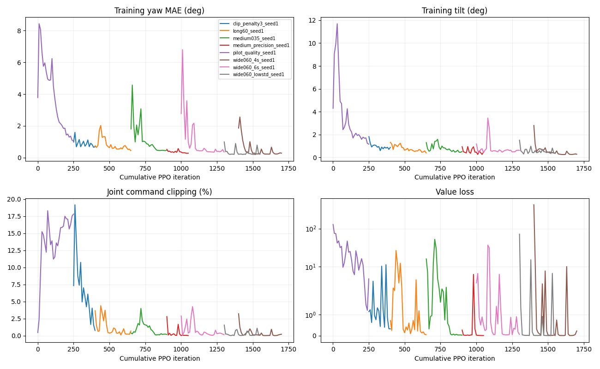

# V2 原始日志汇总

由 `experiments/revo3_v2/summarize.py` 自动生成。不同幅度、周期、回合长度不能直接比较绝对误差或回报。
P95 tilt 是各回合 P95 的平均；gain 列给出所有回合的最差半周期峰值比。训练 steps 是该运行新增步数，不含 resume 的历史。

| 评估 | 后端 | 幅度 rad | 秒/回合 | 回合数 | 严格通过 | 存活 | MAE° | tilt° | 命令裁剪 | 最差 gain |
|---|---|---:|---:|---:|---:|---:|---:|---:|---:|---:|
| [eval_clip400](../../runs/revo3_v2/eval_clip400/metrics.json) | CPU | 0.20 | 12 | 12 | 66.7% | 100.0% | 0.739 | 0.908 | 1.72% | 0.686 |
| [eval_clip400_long](../../runs/revo3_v2/eval_clip400_long/metrics.json) | CPU | 0.20 | 60 | 12 | 8.3% | 50.0% | 9.867 | 8.084 | 12.69% | -1.634 |
| [eval_long650_60s](../../runs/revo3_v2/eval_long650_60s/metrics.json) | CPU | 0.20 | 60 | 12 | 100.0% | 100.0% | 0.273 | 0.429 | 0.87% | 0.976 |
| [eval_long650_gpu60s](../../runs/revo3_v2/eval_long650_gpu60s/metrics.json) | GPU | 0.20 | 60 | 128 | 100.0% | 100.0% | 0.276 | 0.437 | 0.87% | 0.971 |
| [eval_long650_holdout60s](../../runs/revo3_v2/eval_long650_holdout60s/metrics.json) | CPU | 0.20 | 60 | 24 | 100.0% | 100.0% | 0.276 | 0.425 | 0.89% | 0.976 |
| [eval_medium1000_60s](../../runs/revo3_v2/eval_medium1000_60s/metrics.json) | CPU | 0.35 | 60 | 12 | 100.0% | 100.0% | 0.208 | 0.421 | 0.29% | 0.958 |
| [eval_medium1000_gpu60s](../../runs/revo3_v2/eval_medium1000_gpu60s/metrics.json) | GPU | 0.35 | 60 | 128 | 100.0% | 100.0% | 0.197 | 0.430 | 0.21% | 0.957 |
| [eval_medium1000_holdout60s](../../runs/revo3_v2/eval_medium1000_holdout60s/metrics.json) | CPU | 0.35 | 60 | 24 | 100.0% | 100.0% | 0.208 | 0.416 | 0.28% | 0.963 |
| [eval_medium1050_60s](../../runs/revo3_v2/eval_medium1050_60s/metrics.json) | CPU | 0.35 | 60 | 12 | 83.3% | 83.3% | 9.294 | 6.828 | 7.03% | -0.338 |
| [eval_medium1050_gpu60s](../../runs/revo3_v2/eval_medium1050_gpu60s/metrics.json) | GPU | 0.35 | 60 | 128 | 89.8% | 89.8% | 5.042 | 3.891 | 4.08% | -0.476 |
| [eval_medium900_60s](../../runs/revo3_v2/eval_medium900_60s/metrics.json) | CPU | 0.35 | 60 | 12 | 66.7% | 100.0% | 0.391 | 0.575 | 0.67% | 0.873 |
| [eval_medium900_gpu60s](../../runs/revo3_v2/eval_medium900_gpu60s/metrics.json) | GPU | 0.35 | 60 | 128 | 100.0% | 100.0% | 0.377 | 0.629 | 0.50% | 0.919 |
| [eval_pilot100](../../runs/revo3_v2/eval_pilot100/metrics.json) | CPU | 0.20 | 12 | 6 | 0.0% | 66.7% | 5.956 | 3.525 | 26.35% | -0.401 |
| [eval_pilot150](../../runs/revo3_v2/eval_pilot150/metrics.json) | CPU | 0.20 | 12 | 6 | 0.0% | 100.0% | 1.936 | 1.947 | 22.27% | 0.622 |
| [eval_pilot250](../../runs/revo3_v2/eval_pilot250/metrics.json) | CPU | 0.20 | 12 | 12 | 0.0% | 100.0% | 0.880 | 1.024 | 29.67% | 0.793 |
| [eval_wide1200_6s_cpu](../../runs/revo3_v2/eval_wide1200_6s_cpu/metrics.json) | CPU | 0.60 | 60 | 12 | 41.7% | 41.7% | 9.298 | 5.281 | 4.91% | -0.107 |
| [eval_wide1200_6s_gpu_guarded](../../runs/revo3_v2/eval_wide1200_6s_gpu_guarded/metrics.json) | GPU | 0.60 | 60 | 128 | 61.7% | 61.7% | 6.459 | 3.858 | 3.80% | -2.545 |
| [eval_wide1250_6s_cpu](../../runs/revo3_v2/eval_wide1250_6s_cpu/metrics.json) | CPU | 0.60 | 60 | 12 | 50.0% | 50.0% | 17.213 | 9.604 | 8.38% | -0.313 |
| [eval_wide1300_6s_cpu](../../runs/revo3_v2/eval_wide1300_6s_cpu/metrics.json) | CPU | 0.60 | 60 | 12 | 66.7% | 66.7% | 20.537 | 9.330 | 11.13% | -0.029 |
| [eval_wide1300_6s_gpu](../../runs/revo3_v2/eval_wide1300_6s_gpu/metrics.json) [INVALID: capacity overflow] | GPU | 0.60 | 60 | 128 | 47.7% | 50.0% | 23.527 | 11.480 | 13.20% | -2.545 |
| [eval_wide1400_6s_cpu](../../runs/revo3_v2/eval_wide1400_6s_cpu/metrics.json) | CPU | 0.60 | 60 | 12 | 100.0% | 100.0% | 0.204 | 0.556 | 0.24% | 0.984 |
| [eval_wide1400_6s_gpu](../../runs/revo3_v2/eval_wide1400_6s_gpu/metrics.json) | GPU | 0.60 | 60 | 128 | 100.0% | 100.0% | 0.229 | 0.624 | 0.23% | 0.959 |
| [eval_wide1400_6s_holdout](../../runs/revo3_v2/eval_wide1400_6s_holdout/metrics.json) | CPU | 0.60 | 60 | 24 | 100.0% | 100.0% | 0.206 | 0.560 | 0.24% | 0.970 |
| [eval_wide1600_4s_cpu](../../runs/revo3_v2/eval_wide1600_4s_cpu/metrics.json) | CPU | 0.60 | 60 | 12 | 100.0% | 100.0% | 0.243 | 0.298 | 0.14% | 0.949 |
| [eval_wide1600_4s_gpu](../../runs/revo3_v2/eval_wide1600_4s_gpu/metrics.json) | GPU | 0.60 | 60 | 128 | 93.0% | 93.0% | 4.884 | 2.750 | 2.56% | -2.449 |
| [eval_wide1600_4s_holdout](../../runs/revo3_v2/eval_wide1600_4s_holdout/metrics.json) | CPU | 0.60 | 60 | 24 | 95.8% | 95.8% | 3.775 | 2.078 | 1.36% | 0.961 |
| [eval_wide1700_4s_cpu](../../runs/revo3_v2/eval_wide1700_4s_cpu/metrics.json) | CPU | 0.60 | 60 | 12 | 100.0% | 100.0% | 0.327 | 0.358 | 0.40% | 0.945 |
| [eval_wide1700_4s_gpu](../../runs/revo3_v2/eval_wide1700_4s_gpu/metrics.json) | GPU | 0.60 | 60 | 128 | 100.0% | 100.0% | 0.328 | 0.321 | 0.38% | 0.921 |
| [eval_wide1700_4s_holdout](../../runs/revo3_v2/eval_wide1700_4s_holdout/metrics.json) | CPU | 0.60 | 60 | 24 | 100.0% | 100.0% | 0.333 | 0.367 | 0.43% | 0.929 |
| [v1_matched_task_60s](../../runs/revo3_v2/v1_matched_task_60s/metrics.json) | CPU | 0.60 | 60 | 12 | 0.0% | 100.0% | 3.347 | 30.380 | 40.73% | 0.775 |
| [v1_strict_baseline](../../runs/revo3_v2/v1_strict_baseline/metrics.json) | CPU | 0.60 | 12 | 4 | 0.0% | 100.0% | 3.458 | 30.667 | 41.49% | 0.815 |

## 训练末轮分项 loss

总 loss = policy + 0.5 × value − 0.002 × entropy。负的高斯微分熵是有效值。各组 reward/episode 分布不同，loss 不是效果排行榜。

| 运行 | 末轮 | 新增步数 | 用时 s | policy loss | value loss | entropy | 总 loss | KL |
|---|---:|---:|---:|---:|---:|---:|---:|---:|
| clip_penalty3_seed1 | 400 | 4,915,200 | 117.1 | -0.01041 | 0.32521 | -1.81207 | 0.15582 | 0.01294 |
| long60_seed1 | 650 | 8,192,000 | 196.7 | -0.01158 | 0.05028 | -3.15083 | 0.01986 | 0.01246 |
| medium035_seed1 | 900 | 8,192,000 | 221.8 | -0.01042 | 0.02735 | -4.41062 | 0.01207 | 0.01091 |
| medium_precision_seed1 | 1050 | 4,915,200 | 101.3 | -0.01014 | 0.00994 | -5.78577 | 0.00641 | 0.01016 |
| pilot_quality_seed1 | 250 | 8,192,000 | 374.4 | -0.00648 | 4.80822 | -1.49144 | 2.40061 | 0.01125 |
| wide060_4s_seed1 | 1700 | 9,830,400 | 255.8 | -0.00476 | 0.22709 | -19.47781 | 0.14774 | 0.01119 |
| wide060_6s_seed1 | 1300 | 9,830,400 | 254.0 | -0.00933 | 0.06356 | -6.34381 | 0.03514 | 0.01407 |
| wide060_lowstd_seed1 | 1550 | 8,192,000 | 197.6 | -0.00677 | 0.01228 | -19.29858 | 0.03797 | 0.01238 |

