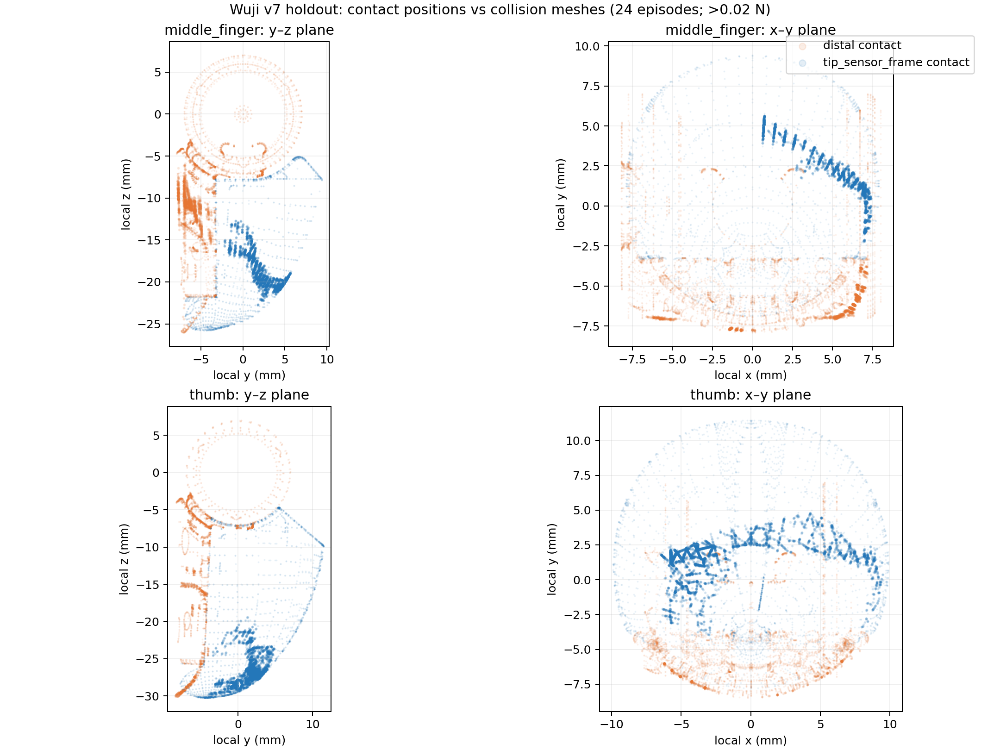
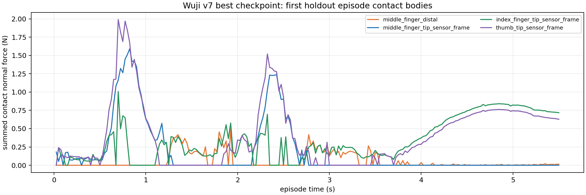

# Wuji v7 contact geometry review (2026-10-17)

This is a **read-only analysis** of the exact 24-episode, 220-frame-per-episode v7 best-checkpoint holdout replay. It does not change the [original stage A result](../stage_a_20261016/REVIEW.md), policy, scene, evaluator, or success gate. The [source contacts](../stage_a_20261016/contact_audit/contact_points_all_episodes.json.gz), [machine-readable summary](summary.json), and [reproduction script](../../../../tools/summarize_wuji_v7_contact_geometry.py) are retained.

The figure overlays actual pen-contact positions (>0.02 N, saturated colored marks) and the two collision meshes' vertices (faint marks) in the **same body-local coordinates**. The `tip_sensor_frame` child bodies have zero translation relative to their corresponding distal bodies in this scene, so their contact point coordinates can be compared directly. Each color denotes the collision body reported by MuJoCo. The plots do not label an anatomical pad region.

| Body | Contact samples >0.02 N | Median local y | 5th–95th percentile local y |
| --- | ---: | ---: | ---: |
| Middle tip-sensor mesh | 4,091 | +2.09 mm | −0.93 to +5.08 mm |
| Middle distal mesh | 1,609 | **−6.55 mm** | **−7.72 to −4.14 mm** |
| Thumb tip-sensor mesh | 7,212 | +1.80 mm | −1.11 to +3.39 mm |
| Thumb distal mesh | 300 | **−6.95 mm** | **−8.06 to −5.69 mm** |
| Index tip-sensor mesh | 11,784 | +6.15 mm | +1.87 to +7.24 mm |
| Index distal mesh | 6 | −5.03 mm | −5.16 to −4.91 mm |

Middle distal contact occurred in all 24 episodes. Its per-episode median local y ranged from **−7.65 to −6.15 mm**; the tip-sensor median ranged from **+1.70 to +2.61 mm**. The negative-y distal load is spatially separate from the tip-sensor cluster in this model, and the same sign separation appears for thumb contacts. These are contact **samples**, not a percentage of video frames or a calibrated pass/fail threshold.

The first holdout episode's time-aligned force traces below can be compared with the [uncut rollout video](../stage_a_20261016/holdout_best9000/rollout.mp4). The middle distal body carries load around the previously flagged handover windows.

## What remains unresolved

- The mesh name `tip_sensor_frame` does not by itself establish a complete anatomical finger pad, and a distal-body collision may include an acceptable pad edge. The above coordinate separation is strong evidence that the old merged force channel hides distinct surfaces, but it cannot decide the human motion verdict.
- The existing [contact audit](../stage_a_20261016/REVIEW.md) found sensor-only dual contact in 75.0%–78.2% of frames per episode. Its 0/24 result under a hypothetical 95% **sensor-only** gate is a diagnostic, not a retroactive rewrite of the frozen original 24/24 gate.
- Before a v8 training reward or strict gate is frozen, a human must identify acceptable contact patches on the colored meshes and review actual release/transfer in the [three-view video and human-reference card](../stage_a_20261016/review.html), especially 1.25–1.65 s and 2.75–3.30 s. Then encode that patch definition in the CPU evaluator and GPU training environment and independently verify they agree.

**Current disposition:** v7 remains a useful short-turn candidate under its original gate. Its natural-contact acceptance is pending. This report alone does not authorize continuous training or turn the rejected v4 motion into a reference.
