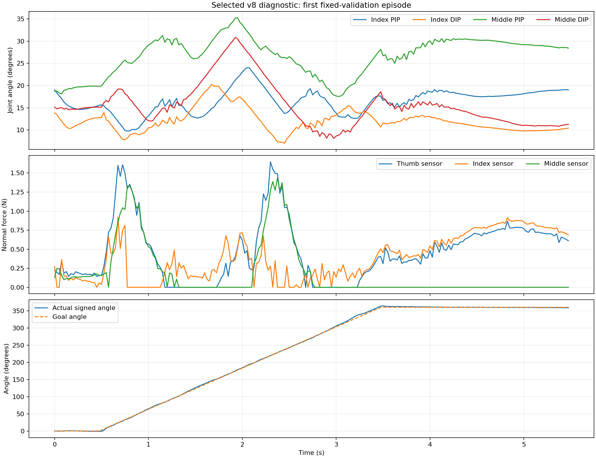

# Wuji v8 sensor-contact pilot: completed diagnostic

**2026-10-17 result:** the isolated pilot finished after **1,224.0 seconds of effective GPU training, 996 PPO updates, and 32,636,928 environment steps**, with no supervisor restart. The fixed-validation-selected final checkpoint completes **24/24** 5.5-second, 3-second-turn episodes, but passes **0/24** of the new conservative sensor-only strict gate. It is a **diagnostic model**, not an approved natural Triangle Pass or an entry to longer continuous training.

[Offline side-by-side review](review.html) · [Selected checkpoint](final_0000996/model.pt) · [Selected three-view video](final_0000996/fixed_validation/rollout.mp4) · [First-episode curves](first_episode_curves.png) · [All 24 episode metrics](final_0000996/fixed_validation/metrics.json) · [Training log](training.log) · [Frozen source hashes](source_manifest.json)

<video controls preload="metadata" playsinline width="960" src="final_0000996/fixed_validation/rollout.mp4"></video>

The selected checkpoint is iteration **996**, SHA256 `066643e4cd236b320d13518ae53c5b089084a38760784d41492b8f9ebfa7efaf`. [selection.json](selection.json) applies the [rule written before the final validation](../PILOT_SELECTION_RULE.md): strict pass count, complete duration count, lower non-sensor force fraction, higher dual-sensor fraction, then earlier iteration. The final weight was evaluated on the **same fixed seed `2026101701`**, and the independent unseen seed `2026101703` was **not opened** because no candidate passed the fixed gate. The [last periodic iteration-900 weight](iteration_0000900/model.pt), SHA256 `b8938fd479e319504bc5e2142a44967d98c33cd9aacca5ad3ebd475e5a8fcf16`, remains available separately.

| Fixed validation (24 episodes) | Complete 5.5 s | Strict pass | Mean dual sensor contact | Mean non-sensor force >0.05 N | Mean sensor-only opposing contact | Mean angle error |
| --- | ---: | ---: | ---: | ---: | ---: | ---: |
| [Frozen v7 source under v8 gate](../preflight_20261017/baseline_v7_legacy_obs_sensor_gate/metrics.json) | 24/24 | 0/24 | 76.9% | 27.9% | 74.9% | 0.58° |
| [Iteration 300 failure](iteration_0000300/fixed_validation/metrics.json) | 21/24 | 0/24 | 77.8% | 24.3% | 76.5% | see raw metrics |
| [Iteration 600](iteration_0000600/fixed_validation/metrics.json) | 24/24 | 0/24 | 81.6% | 21.5% | 80.6% | see raw metrics |
| [Iteration 900](iteration_0000900/fixed_validation/metrics.json) | 24/24 | 0/24 | 82.3% | 18.8% | 81.8% | see raw metrics |
| [Selected final 996](final_0000996/fixed_validation/metrics.json) | **24/24** | **0/24** | **83.1%** | **17.3%** | **82.6%** | **1.31°** |

Relative to the controlled baseline, the selected weight gains about **6.2 percentage points** of dual sensor contact and reduces non-sensor-force frames by about **10.7 points**. Angle error rises from 0.58° to 1.31° but remains below the frozen 10° machine limit. All 24 selected episodes still fail each of the dual-sensor >95%, non-sensor <5%, and opposing >90% gates; 3 also fail the counted-handover gate. The intermediate iteration-300 regression retains its [first-episode three-view video](iteration_0000300/fixed_validation/rollout.mp4) and [all 24 episode metrics](iteration_0000300/fixed_validation/metrics.json). Three episodes in that batch end early, with additional posture and terminal regrasp failures; the displayed first episode itself runs the full 5.5 seconds. The final 0/24 result must not be promoted because the trends improved.

## What this pilot tested

- The v7 iteration-9000 policy parameters were an explicitly labeled **diagnostic warm start**. The copied v8 scene and grasp bank have SHA256 provenance in [assets](../../../../assets/wuji_hand2_palm_up_human_demo_v8/provenance.json). The exact 111-dimensional legacy merged-contact vector remains the policy's input to avoid a large input distribution shift; GPU reward/grip logic and the independent CPU strict gate use **sensor-only** force channels, with distal-body contacts counted as non-sensor force. Both force vectors are kept in selected [frame metrics](final_0000996/fixed_validation/frame_metrics.json). The [preflight report](../preflight_20261017/REVIEW.md) preserves the failed input-shift probe and controlled baseline.
- The [executable config](../../../../experiments/wuji_hand2/palm_up_human_demo_v8/long_training/config.json) fixed a single 3-second-turn level, v7's course-only reward variant, 1e-4 initial learning rate, 1,024 parallel environments, 32-step rollout, 20-minute effective budget, and fixed 24-episode CPU validations every 100 updates. The v8 source was committed before the pilot completed. [Training status](training_status.json), [metrics JSONL](metrics.jsonl), [warm-start record](warm_start.json), and [supervisor finish record](supervisor_finished.json) are archived.
- Every periodic fixed validation from iterations 100–900 plus the final iteration 996 has its own `fixed_validation/` directory here, containing a checkpoint-matched metrics JSON, uncut three-view video, first-episode frame/contact data, trajectory, and preview frames. Selected and several intermediate weights are archived; videos and raw metrics remain available for the other failed checkpoints.

## Decision and next experiment

**Do not start a 10-, 30-, 60-, or 120-second course, or a 21-hour continuation of this reward variant.** The current sensor-only gate remains a deliberately narrow proxy; the [v7 collision-mesh contact map](../../palm_up_human_demo_v7/contact_geometry_20261017/REVIEW.md) shows distinct loaded surfaces but does not prove which distal patches are anatomically acceptable. First obtain the human verdict on the [three-view comparison](review.html) and mark the acceptable pad surface on the model. Then freeze that calibrated region definition and run a new isolated short ablation targeting persistent non-pad support and real release/handover. Preserve this 0/24 result as a failed strict baseline.
