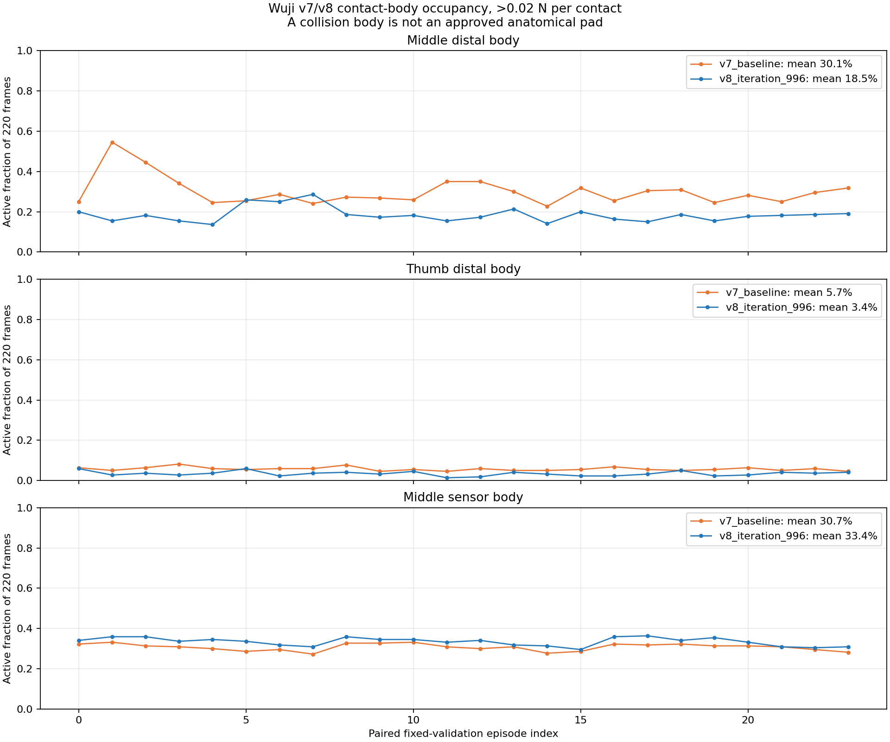
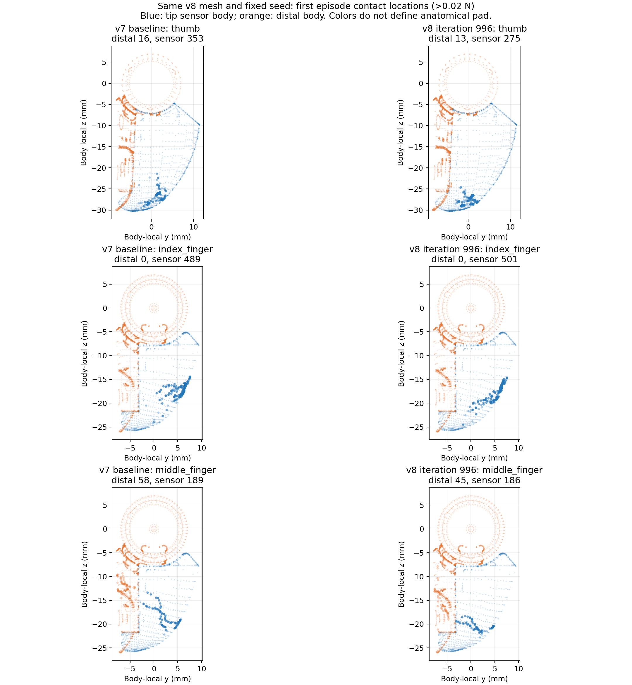
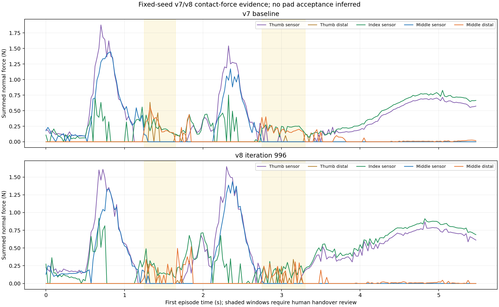

# Wuji v9 Gate 0: contact-surface evidence for human review

**Status:** read-only comparison completed on 2026-10-19. Anatomical pad boundaries and v7/v8 motion naturalness remain **unconfirmed**. No v9 training or new holdout evaluation was run. The [v9 execution plan](../../../../experiments/wuji_hand2/palm_up_human_demo_v9/PLAN.md) requires those decisions before a calibrated contact gate or short pilot can be frozen.

[Offline comparison cards](../../../../artifacts/wuji_hand2/palm_up_human_demo_v9/review.html) · [24-episode source and replay checks](replay_checks.json) · [24-episode per-body statistics](full_24_contact_summary.json) · [First-episode plot statistics](summary.json) · [Reproduction scripts](../../../../tools/replay_wuji_v9_fixed_contacts.py)

## Full fixed-validation set, same 24 starting conditions

Both frozen checkpoints were independently replayed on the **already opened** fixed seed `2026101701`; all **24/24** episode durations and final signed angles match their archived metrics exactly (maximum angle discrepancy **0.0°**). The full [v7 contact archive](v7_baseline_all_contacts.json.gz) and [v8 contact archive](v8_iteration_996_all_contacts.json.gz) contain the actual pen-contact body, body-local/world position and normal force for each frame. No unseen seed was opened.



| Contact body, >0.02 N | v7 mean active frames | v8 mean active frames | Change |
| --- | ---: | ---: | ---: |
| Middle distal body | 30.1% | **18.5%** | −11.6 percentage points |
| Thumb distal body | 5.7% | 3.4% | −2.3 points |
| Middle tip-sensor body | 30.7% | 33.5% | +2.7 points |

Middle distal-body occupancy decreases in **22/24** paired episodes. That is a measured reduction in this collision body's load, not proof of approved pad contact or a natural release. The full 24-episode summary keeps per-episode fractions and local contact coordinates so a later **human-approved** region definition can be applied without altering the original v7/v8 results.

## First-episode mesh position and handover timing





Both robot samples use the **same v8 scene**, fixed CPU validation seed `2026101701`, 5.5-second first episode, and 0.02 N point filter. The v7 sample is the [frozen v7 iteration-9000 policy under the v8 evaluator](../../palm_up_human_demo_v8/preflight_20261017/baseline_v7_legacy_obs_sensor_gate/metrics.json); the v8 sample is the [selected iteration-996 diagnostic policy](../../palm_up_human_demo_v8/pilot_20261017/final_0000996/fixed_validation/metrics.json). Their exact [v7 video](../../palm_up_human_demo_v8/preflight_20261017/baseline_v7_legacy_obs_sensor_gate/rollout.mp4) and [v8 video](../../palm_up_human_demo_v8/pilot_20261017/final_0000996/fixed_validation/rollout.mp4) are uncut, three-view policy rollouts. The [approved human reference](../../palm_up_human_demo_v8/pilot_20261017/human_A.mp4) is shown separately; no phase synchronization is claimed.

| First episode body, >0.02 N | v7 active frames / 220 | v8 active frames / 220 | What is known |
| --- | ---: | ---: | --- |
| Thumb tip-sensor body | 166 | 176 | Sensor-body load increases in this episode. |
| Thumb distal body | 14 | 13 | Distal load remains. |
| Index tip-sensor body | 184 | 184 | Index sensor load is present through much of both episodes. |
| Index distal body | 0 | 0 | No above-filter contact in either first episode. |
| Middle tip-sensor body | 71 | 75 | Middle sensor load increases slightly. |
| Middle distal body | **55** | **44** | Distal load falls but is still present in one fifth of v8 frames. |

These are **first-episode frame counts**, not the 24-episode acceptance fractions. The complete fixed validations remain **0/24 strict** for each policy under the conservative `tip_sensor_frame` proxy. The plots show the middle-finger distal contact cluster on a different side of the local y coordinate from the sensor cluster, consistent with the [earlier 24-episode v7 mesh audit](../../palm_up_human_demo_v7/contact_geometry_20261017/REVIEW.md). A collision-body name or local y sign does **not** establish what is anatomically acceptable. In the shaded 1.25–1.65 s and 2.75–3.30 s windows, inspect actual release, handover, and whether a side surface props up the pen.

## Decisions still needed before a v9 classifier

1. Mark v7 and v8 motion separately as acceptable candidate, rejected, or unresolved after comparing the three-view rollouts with the human clip. Identify any crossing or false handover by time. A rejected policy must remain failure evidence and cannot become an imitation target.
2. For thumb, index, and middle finger, mark the allowed pad patch on the **actual collision mesh**, including any distal-body edge that is genuinely acceptable. Record local coordinates, geometric boundary, ambiguity at occlusion, and the chosen force threshold in a versioned v9 asset. The current figures deliberately contain **no approved pad label**.
3. Recheck labeled points against the recorded pen positions and video at representative early, handover, and terminal frames. Then compare the same classifier in CPU evaluation and GPU training on labeled samples. Freeze the criterion before viewing v9 training outcomes.

Until these decisions are made, neither v7's old merged-contact success nor v8's improved sensor-only fractions certify natural pen spinning. Seed `2026101703` remains unopened.

## Reproduce the read-only analysis

From the repository root, using the existing Python environment:

```bash
PYTHONPATH=. .venv-warp/bin/python tools/replay_wuji_v9_fixed_contacts.py
.venv-warp/bin/python tools/summarize_wuji_v9_fixed_contacts.py
.venv-warp/bin/python tools/compare_wuji_v9_contact_surfaces.py
```

The [replay script](../../../../tools/replay_wuji_v9_fixed_contacts.py) checks the checkpoint and scene hashes, seed, duration, and signed angle against the frozen metrics before writing the 24-episode archives. The [summary script](../../../../tools/summarize_wuji_v9_fixed_contacts.py) and [mesh plot script](../../../../tools/compare_wuji_v9_contact_surfaces.py) read only those archives and the already archived first episodes. The first-episode contact arrays also match the original files exactly.
